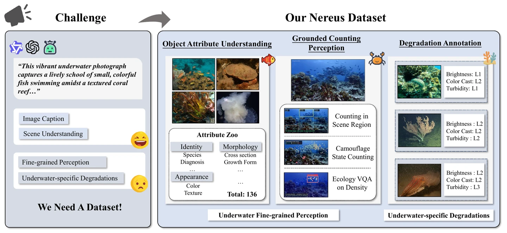
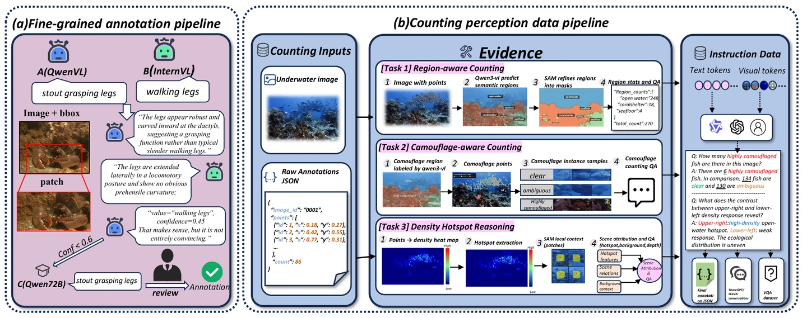

# Nereus: A Large-Scale Underwater Dataset for Fine-Grained Attribute Understanding and Grounded Counting Perception

**Jingtao Deng<sup>1,*</sup>, Zihao Jin<sup>1,*</sup>**, Yuehe Chen<sup>1</sup>, Feixiang He<sup>2</sup>, Shuiwang Li<sup>3</sup>, Dan Zeng<sup>1,&dagger;</sup>

<sup>1</sup> Sun Yat-sen University &nbsp; <sup>2</sup> Central South University &nbsp; <sup>3</sup> Guilin University of Technology<br>
<sup>*</sup> Equal contribution &nbsp; <sup>&dagger;</sup> Corresponding author

[**Project Page**](https://brl-sysu.github.io/Nereus/) | [**Dataset**](https://huggingface.co/datasets/Nereusdata/Nereus) | [**Citation**](#citation)<br>
Paper and arXiv links will be added when the public manuscript is available.

Nereus connects underwater visual perception with fine-grained attribute
understanding and grounded counting. Its counting annotations cover semantic
regions, camouflage states, and density hotspots with contextual environmental
reasoning. The project page contains interactive examples drawn from annotated
data, rather than model predictions.



## Release Status

This initial research-code release includes P2PNet training/evaluation,
CountGD and CLIP-Count evaluation, closed-VLM counting evaluation, and count-range
analysis. It is **not yet a complete reproduction package for every paper
experiment**. Fine-grained attribute training and full open-VLM fine-tuning
pipelines are not included. Weights, private API credentials, raw predictions,
and the original manuscript are not committed.

## Environment

Use Python 3.10 or later. Install a matching PyTorch/torchvision pair for your
CUDA environment, then install the shared dependencies:

```bash
python -m venv .venv
source .venv/bin/activate
pip install torch torchvision
pip install -r requirements.txt
```

This is a shared dependency list, not a fully pinned environment for every
external model. CountGD and CLIP-Count additionally require their upstream
dependencies and checkpoints in compatible environments.

## Data Preparation

Download [Nereus on Hugging Face](https://huggingface.co/datasets/Nereusdata/Nereus).
Keep the Nereus benchmark split and original IOCfish5K split distinct; do not
substitute one for the other when reproducing a result.

The scripts use the historical experiment layout. Link or stage RGB images,
final annotation JSONs, and the matching frozen split IDs as follows:

```text
Nereus/
  test_dataset/
    images/                  # <image_id>.jpg
    final_annotations/       # <image_id>.json
  Experiments/
    canonical_dataset/
      splits/splits.json     # train, val, test: arrays of image IDs
    p2pnet_nereus/data/       # generated manifests, not committed
  models/                    # external source/checkpoints, not committed
```

The baseline scripts expect split sizes **3,945 / 563 / 1,129**. Use the matching
frozen IDs; do not generate a new random split and call it the paper split.
Data-building utilities require the intermediate QA/density assets described in
[the canonical-data guide](Experiments/README_canonical_dataset.md).

```bash
python -m Experiments.p2pnet_nereus.prepare_data
```

This creates label-bearing manifests and a separate `test_images.jsonl` for
label-free inference. Run all research commands from the repository root.

## Training

P2PNet uses pinned upstream source, an audited compatibility patch, and
ImageNet-only VGG16-BN initialization:

```bash
bash Experiments/p2pnet_nereus/download_assets.sh
CUDA_VISIBLE_DEVICES=0,1 torchrun --standalone --nproc_per_node=2 \
  -m Experiments.p2pnet_nereus.train \
  --epochs 300 --batch-size-per-gpu 4 --eval-every 5 --seed 42
python -m Experiments.p2pnet_nereus.calibrate
python -m Experiments.p2pnet_nereus.infer --split test
```

Checkpoint selection and confidence calibration use validation data only.
See [P2PNet details](Experiments/p2pnet_nereus/README.md).

## Evaluation

| Module | Released functionality | Guide |
| --- | --- | --- |
| P2PNet | Preparation, training, calibration, inference, metrics | [Guide](Experiments/p2pnet_nereus/README.md) |
| External counting | CountGD / CLIP-Count direct zero-shot inference and metrics | [Guide](Experiments/external_counting_nereus/README.md) |
| Closed VLMs | Frozen prompts, cached API inference, parsing and scoring | [Guide](Experiments/closed_vlm_nereus/README.md) |
| Count-range analysis | Ground-truth count bins, metrics and bootstrap analysis | [Guide](Experiments/rebuttal/count_range/README.md) |

```bash
python -m Experiments.p2pnet_nereus.evaluate
python -m Experiments.external_counting_nereus.evaluate
python -m Experiments.closed_vlm_nereus.run --model gpt-5 --limit 3 --dry-run
python Experiments/rebuttal/count_range/count_range_eval.py --help
```

Evaluators require prepared manifests and prediction files. Count-range analysis
additionally needs canonical/Track A/Track B records and joint-response caches;
these artifacts are not bundled. Missing predictions must not be treated as zero
scores. Closed-model live runs send images to the configured API provider and
incur charges; inspect the endpoint and data-sharing terms first. Never commit
API keys. The dry-run does not make inference requests.

## Tests

CPU metric/protocol checks without model downloads or API calls:

```bash
python -m unittest \
  Experiments.p2pnet_nereus.tests.test_grid_metrics \
  Experiments.external_counting_nereus.tests.test_config \
  Experiments.external_counting_nereus.tests.test_adapters \
  Experiments.external_counting_nereus.tests.test_dataset \
  Experiments.external_counting_nereus.tests.test_evaluate \
  Experiments.external_counting_nereus.tests.test_prediction_cache \
  Experiments.external_counting_nereus.tests.test_io \
  Experiments.closed_vlm_nereus.tests.test_protocol
python -m unittest discover -s Experiments/rebuttal/count_range/tests
```

Other integration/GPU tests require the corresponding artifacts and hardware.

## Annotation Pipeline



## Project Page

The public site is hosted at [brl-sysu.github.io/Nereus](https://brl-sysu.github.io/Nereus/).
This branch contains research code only; website source and build tooling are
not included. Python experiments do not need Node.js.

## Acknowledgements and Rights

We thank the authors of [IOCfish5K](https://github.com/GuoleiSun/Indiscernible-Object-Counting),
[P2PNet](https://github.com/TencentYoutuResearch/CrowdCounting-P2PNet),
[CountGD](https://github.com/niki-amini-naieni/CountGD), and
[CLIP-Count](https://github.com/songrise/CLIP-Count).
External models and data retain their licenses. IOCfish5K is CC BY-NC 4.0;
this is not a blanket license over all Nereus components or code. Software
licensing is pending owner selection. See [NOTICE](NOTICE). Permission to publish curated website
examples does not grant unrestricted downstream adaptation rights.

## Citation

Provisional manuscript citation; venue and identifier will be updated with the
public paper:

```bibtex
@misc{deng2026nereus,
  title = {Nereus: A Large-Scale Underwater Dataset for Fine-Grained Attribute Understanding and Grounded Counting Perception},
  author = {Deng, Jingtao and Jin, Zihao and Chen, Yuehe and He, Feixiang and Li, Shuiwang and Zeng, Dan},
  year = {2026},
  url = {https://brl-sysu.github.io/Nereus/}
}
```
